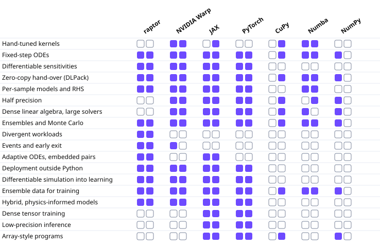

```{raw} html
<div class="raptor-hero">
  
</div>
```

# hawk

**One kernel, two machines.** hawk is a Python DSL (domain-specific
language) for writing a numerical kernel once and running it, unchanged,
on CPU or GPU.

```{raw} html
:file: _static/ecosystem/ecosystem_cards_hawk.html
```

**What hawk kernels do under eagle**

```{raw} html
<figure class="perf-glimpse">
<a href="https://amasat01.github.io/eagle/content/performance.html"></a>
<figcaption>A million RK4 oscillators, each stopping at its own step, written as one hawk kernel and run by eagle: wall time per tool, log scale. Measured by eagle's committed performance cards. <a href="https://amasat01.github.io/eagle/content/performance.html">Every device, workload and arm</a>.</figcaption>
</figure>
```

A kernel is a plain Python function decorated `@hawk.kernel`. hawk turns
it into a small typed representation of what it computes, derives its
forward- and reverse-mode derivatives from that representation, and
compiles it for the [eagle](https://amasat01.github.io/eagle/) runtime to
run.



*Where each tool covers the work.* The [comparison across tools](https://amasat01.github.io/where_raptor_fits.html) has the charts and the numbers behind them.

```python
import hawk
from hawk import Mutable, Param, Scalar

@hawk.kernel
def scale(x: Scalar, a: Param, b: Param, y: Mutable[Scalar]):
    y = a * x + b
```

That is the whole authoring surface: a declared vocabulary of planes — a
plane is the role one argument plays for every sample, such as a per-sample
input, a shared constant, or an output — and each parameter's type says
which plane it fills (`Scalar` a per-sample input, `Param` a uniform
constant, `Mutable[...]` an output plane; defined in full in the first
tutorial, next), plus an ordinary arithmetic body.
`hawk.build` compiles it for host and device in one call —
`pip install raptor-hawk` (the CPU route; for a GPU add the `[cuda12]` or `[cuda13]` extra, see the
[full install guide](content/installation)) is all it takes to try it.

::::{grid} 2
:gutter: 3

:::{grid-item-card} Start here
:link: content/tutorials/01_your_first_kernel
:link-type: doc
Write, build and run a kernel in about five minutes — then run the same
one on a GPU with the same call.
:::

:::{grid-item-card} Tutorials
:link: content/tutorials
:link-type: doc
Arguments and shapes, stopping conditions, gradients backward and
forward, lookups and sums.
:::

:::{grid-item-card} Vocabulary
:link: content/vocabulary
:link-type: doc
Write your own vocabulary and pair it to a new kernel kind: inheritance, a
custom derivative, and a capstone running the whole stack through PyTorch.
:::

:::{grid-item-card} Reference
:link: content/api/index
:link-type: doc
Every public name in `hawk`, `hawk.math`, `hawk.ext`, `hawk.diff`,
`hawk.compile` and `hawk.runtime`.
:::
::::

New to the whole RAPTOR family? The landing page's
[Start here](https://amasat01.github.io/start_here.html) walks through one
kernel, a million samples and a PyTorch fit in ten minutes, across every
repo at once.

## Where hawk sits

hawk is the kernel-authoring layer of the RAPTOR family. It writes and
compiles kernels, and `hawk.runtime` runs a host build directly; it never
launches a DEVICE artifact itself — that is deployed and run by
[eagle](https://amasat01.github.io/eagle/), the family's GPU execution
layer, over the protocol [raptor](https://amasat01.github.io/raptor/)
defines and [aether](https://amasat01.github.io/aether/) provides the
vector-algebra vocabulary for.

```text
aether (numerics core)  --->  eagle (execution)  <---  raptor (contracts)  --->  hawk (kernel authoring)
```

aether lays out arrays and provides the device-safe vector-algebra
vocabulary; eagle launches and captures what runs on top of it; raptor is
the dependency-free foundation that defines the manifest and protocol
contracts eagle and hawk both build to without depending on each other;
hawk authors and compiles the kernels eagle deploys.

```{toctree}
:caption: Start here
:maxdepth: 1
:hidden:

content/installation
content/quickstart
```

```{toctree}
:caption: Tutorials
:maxdepth: 1
:hidden:

content/tutorials
```

```{toctree}
:caption: Vocabulary
:maxdepth: 1
:hidden:

content/vocabulary
```

```{toctree}
:caption: How-to guides
:maxdepth: 1
:hidden:

content/examples
```

```{toctree}
:caption: Explanation
:maxdepth: 1
:hidden:

content/across_samples
content/control_vs_warp
content/compiling
content/embedded
content/interop
```

```{toctree}
:caption: Reference
:maxdepth: 1
:hidden:

content/api/index
content/glossary
```

```{toctree}
:caption: Contributing
:maxdepth: 1
:hidden:

content/contributing
```
